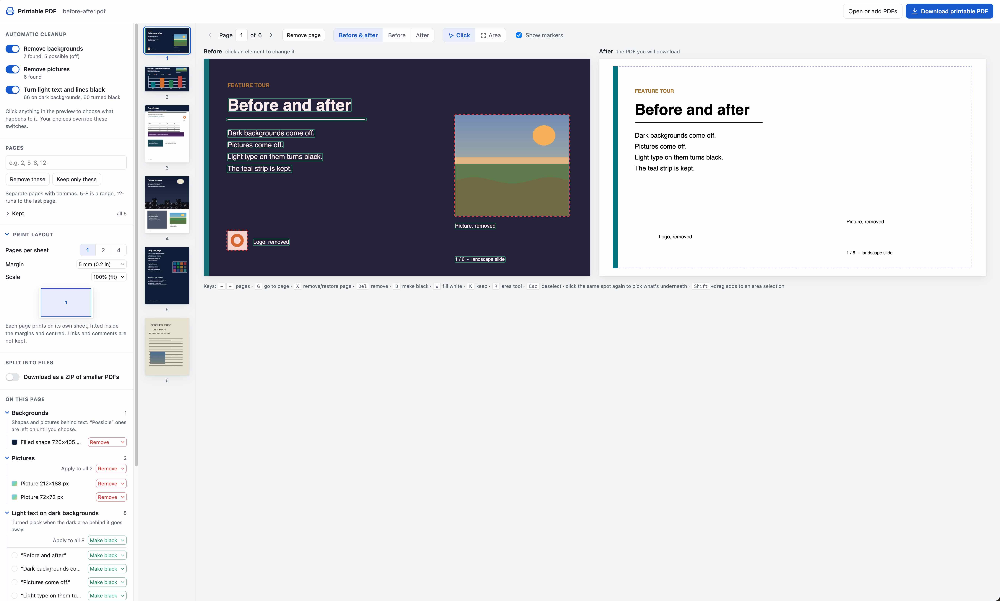
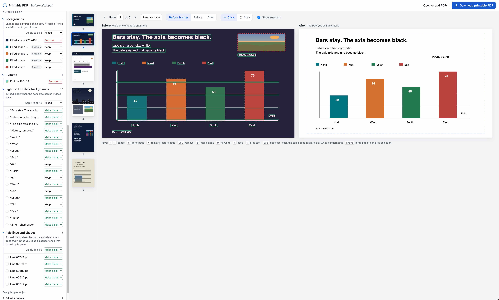
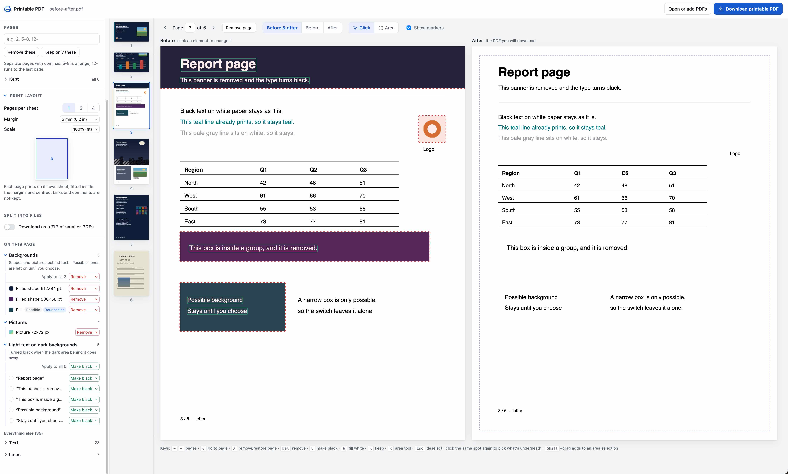
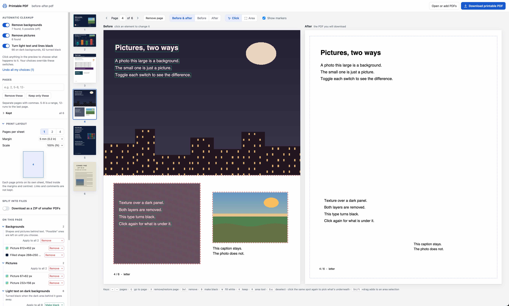

# Printer Friendly PDF

Make PDFs printer-friendly: remove dark backgrounds and pictures, and turn light text black, while keeping
the layout and real, selectable text. Everything runs in the browser, so files are never uploaded.

**[Live demo](https://alexadam.github.io/demos/printer-friendly/)**







## Features

- **Private.** The file never leaves the browser.
- **Automatic cleanup.** Remove dark backgrounds and pictures, and turn light text and pale lines black. Switches set the defaults; your choices override them.
- **Pick any element.** Click it in the preview (click the same spot again for what is underneath), choose it in the sidebar, apply one action to a whole group, or drag a rectangle with the Area tool.
- **Actions.** Keep, remove, fill white (filled shapes), or make black (text and shapes).
- **Before and after.** Preview the original and the edited PDF side by side, or either one alone, with markers on the elements.
- **Combine PDFs.** Open or drop several files, reorder or leave some out, then edit the joined result. Edits already made on an open PDF carry over.
- **Page thumbnails.** Jump to any page. Removed pages are struck through, and long documents load thumbnails as they scroll into view.
- **Remove pages.** Leave pages out by number or range (`2, 5-8, 12-`), keep only the ones you list, or drop the page you are looking at. At least one page stays.
- **Print layout.** Place 1, 2, or 4 pages on each sheet, set margins (including negative, to crop borders), and scale every page from 10% to 400%.
- **Split the download.** Save a ZIP of smaller PDFs, each with a set number of pages (or sheets, when several pages share a sheet).
- **Real text.** Layout and selectable text stay. Only edited pages are rewritten. Links, comments, and form fields stay with their pages.
- **Keyboard.** Arrow keys change page; shortcuts remove or restore a page, recolor the selection, switch to the Area tool, or jump to a page number.
- **Scans.** A scanned page is detected and left alone, since the words and the background are one picture.

```
./start.sh            # installs dependencies, serves on http://localhost:8000
./build.sh            # writes a static site to dist/ for GitHub Pages or Netlify
npm test              # engine + heuristics tests (Node)
npm run samples       # regenerates samples/*.pdf for manual testing
```

